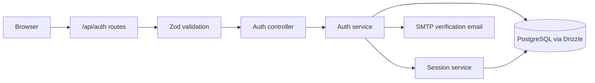
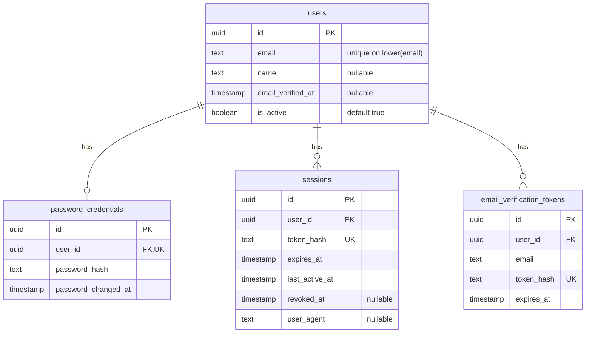

# Authentication internals

The server uses Express, Zod, Drizzle ORM, and PostgreSQL. Passwords use Argon2; sessions use opaque random tokens.

## Request path



Paths below are relative to `apps/server/src/`.

| File | Responsibility |
| --- | --- |
| `routes/auth.routes.ts` | Connect endpoints to validation and controllers. |
| `validators/auth.schema.ts`, `middlewares/validate.ts` | Validate request bodies and replace `req.body` with parsed values. |
| `controllers/auth.controller.ts` | Format HTTP responses and configure the session cookie. |
| `services/auth.service.ts` | Register users, verify email, and check login credentials. |
| `services/session.service.ts`, `utils/Auth.ts` | Create sessions, generate tokens, and hash tokens. |
| `db/schema/auth.ts` | Define all four auth tables; re-exported by `db/schema/index.ts`. |

Validation lowercases emails, trims registration names (1–100 characters), and requires passwords of 8–128 characters. Verification tokens must be 43 base64url characters. Direct service calls do not run this validation.

## Database schema

Key fields are shown below; timestamp metadata is omitted where it does not affect the flow.



All child `user_id` foreign keys cascade on user deletion. Sessions require `expires_at > created_at`; session user/expiry and verification user lookups are indexed.

## Registration and verification

```mermaid
sequenceDiagram
    participant C as Client
    participant A as Auth API
    participant D as PostgreSQL
    participant M as SMTP
    C->>A: POST /api/auth/register
    A->>A: Validate input; hash password; generate token
    A->>D: Transaction: create/update user, credentials, token hash
    D-->>A: Commit
    A->>M: Send raw token in verification link
    A-->>C: 201 with id, email, name
    C->>A: POST /api/auth/verify-email {token}
    A->>D: Transaction: consume valid token; mark email verified
    D-->>A: Commit
    A-->>C: 200 confirmation
```

- **Register:** a verified email returns `409 EMAIL_TAKEN`. Re-registering an unverified email updates its name and password and replaces its verification tokens. Database uniqueness violations also map to `EMAIL_TAKEN`.
- **Email delivery:** happens after commit. If SMTP fails, the user and token remain saved even though the request fails. The link targets `${APP_URL}/verify-email?token=...`; the client must submit the token to the API.
- **Verify:** tokens expire after 24 hours. The transaction deletes a matching unexpired token and updates an active, unverified user whose email still matches. Failure rolls back both operations and returns `400 INVALID_VERIFICATION_TOKEN`; success consumes the token once.

## Login and sessions

`POST /api/auth/login` validates input, finds the user by case-insensitive email together with their password credentials, and calls `verify(storedHash, input.password)`. An unknown email, missing credentials, a wrong password and an inactive account all return the same `401 INVALID_CREDENTIALS`; an unknown email is still checked against a dummy Argon2 hash so response timing does not reveal which emails are registered. Only after the password is proven correct does an unverified account get `403 EMAIL_NOT_VERIFIED`.

After a valid password, `createSession(user.id, userAgent)` generates a fresh token and inserts its SHA-256 hash, the request User-Agent, and a seven-day expiry. The service returns `{ user: { id, name, email }, session: { token, expiresAt } }` to the controller.

Both session and verification tokens use 32 random bytes encoded as base64url. Only their SHA-256 hashes are stored in the database; raw tokens go to the browser or verification email. Password hashes use Argon2 separately.

The login controller sets a `session` cookie with `HttpOnly`, `SameSite=Lax`, `Path=/`, `Secure` in production, and the session expiry when the body has `remember: true` (otherwise it is a browser-session cookie), then returns `{ data: { id, name, email } }`.

### Current user

`GET /api/auth/me` returns `{ data: { id, name, email } }` for an authenticated user and `401 UNAUTHORIZED` otherwise. Responses use `Cache-Control: no-store`.

Cookie parsing runs before the routes. The reusable `middlewares/requireAuth.ts` middleware reads the HttpOnly `session` cookie, validates its token format, and hashes it to look up the session and its user. Missing, expired, revoked, or unknown sessions and inactive users are rejected. Successful requests have a typed `req.user` for downstream handlers.

The browser sends the cookie automatically for same-origin requests; frontend fetch calls can explicitly use `credentials: "include"`. The raw token is never returned by `/me`.

### Logout

`POST /api/auth/logout` sets `revoked_at` on the session matching the cookie, so the token stops working even if a copy survives, and clears the cookie. It always answers `204`, including for a missing or unknown cookie.

### CSRF

`middlewares/verifyOrigin.ts` runs on every `/api` route. Requests other than GET/HEAD/OPTIONS whose `Origin` header is present but differs from `APP_URL` get `403 FORBIDDEN_ORIGIN`. Requests without an `Origin` (non-browser clients) pass. This sits on top of `SameSite=Lax` and also covers sibling subdomains, which SameSite treats as same-site.

### Frontend

The Next.js client calls same-origin `/api/*`, which `next.config.ts` rewrites to the Express server (`API_URL`, default `http://localhost:5000`). The session cookie therefore stays first-party, the API needs no CORS, and no token is ever readable from JavaScript. `proxy.ts` does optimistic redirects only (`/dashboard` without a cookie → `/`, `/` with one → `/dashboard`); the API remains the authority, and the dashboard calls logout and returns to `/` on any `401`.

### Current implementation gaps

- Expired/revoked session cleanup is not implemented, and `lastActiveAt` is only initialized.
- There is no login rate limiting or account lockout yet.

## Errors

`middlewares/errorHandler.ts` sends `AppError` responses as `{ error: { code, message, details } }`. Invalid input returns `400 VALIDATION_ERROR`, malformed JSON returns `400 INVALID_JSON`, and unexpected errors return `500 INTERNAL_ERROR`.
