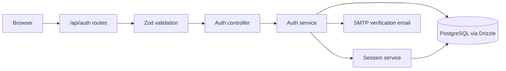
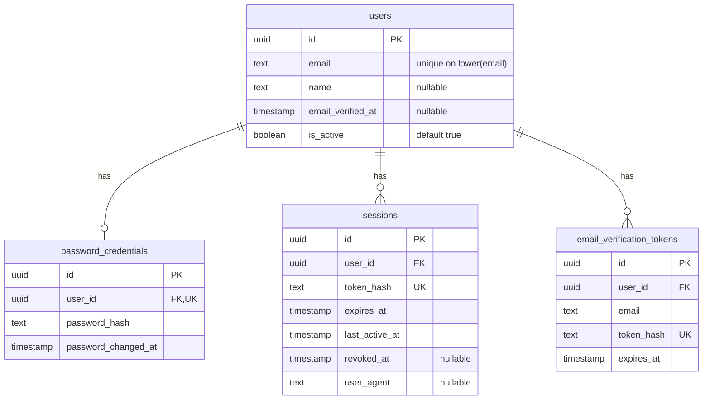

# Authentication internals

The server uses Express, Zod, Drizzle ORM, and PostgreSQL. Passwords use Argon2; sessions use opaque random tokens. This guide describes the current implementation, including the unfinished login behavior.

## Request path



Paths below are relative to `apps/server/src/`.

| File | Responsibility |
| --- | --- |
| `routes/auth.routes.ts` | Connect endpoints to validation and controllers. |
| `validators/auth.schema.ts`, `middlewares/validate.ts` | Validate request bodies and replace `req.body` with parsed values. |
| `controllers/auth.controller.ts` | Format HTTP responses and configure the session cookie. |
| `services/auth.service.ts` | Register users, verify email, and check login credentials. |
| `services/session.service.ts`, `utils/Auth.ts` | Create sessions, generate tokens, and hash tokens. |
| `db/schema/auth.ts` | Define all four auth tables; re-exported by `db/schema/index.ts`. |

Validation lowercases emails, trims registration names (1–100 characters), and requires passwords of 8–128 characters. Verification tokens must be 43 base64url characters. Direct service calls do not run this validation.

## Database schema

Key fields are shown below; timestamp metadata is omitted where it does not affect the flow.



All child `user_id` foreign keys cascade on user deletion. Sessions require `expires_at > created_at`; session user/expiry and verification user lookups are indexed.

## Registration and verification

```mermaid
sequenceDiagram
    participant C as Client
    participant A as Auth API
    participant D as PostgreSQL
    participant M as SMTP
    C->>A: POST /api/auth/register
    A->>A: Validate input; hash password; generate token
    A->>D: Transaction: create/update user, credentials, token hash
    D-->>A: Commit
    A->>M: Send raw token in verification link
    A-->>C: 201 with id, email, name
    C->>A: POST /api/auth/verify-email {token}
    A->>D: Transaction: consume valid token; mark email verified
    D-->>A: Commit
    A-->>C: 200 confirmation
```

- **Register:** a verified email returns `409 EMAIL_TAKEN`. Re-registering an unverified email updates its name and password and replaces its verification tokens. Database uniqueness violations also map to `EMAIL_TAKEN`.
- **Email delivery:** happens after commit. If SMTP fails, the user and token remain saved even though the request fails. The link targets `${APP_URL}/verify-email?token=...`; the client must submit the token to the API.
- **Verify:** tokens expire after 24 hours. The transaction deletes a matching unexpired token and updates an active, unverified user whose email still matches. Failure rolls back both operations and returns `400 INVALID_VERIFICATION_TOKEN`; success consumes the token once.

## Login and sessions

`POST /api/auth/login` validates input, finds the user by email, loads password credentials, and calls `verify(storedHash, input.password)`. A missing user currently returns `400 EMAIL_INVALID`; missing credentials or a wrong password returns `401 INVALID_CREDENTIALS`.

After a valid password, `createSession(user.id)` generates a fresh token and inserts its SHA-256 hash with a seven-day expiry. The service returns `{ user: { id, name, email }, session: { token, expiresAt } }` to the controller.

Both session and verification tokens use 32 random bytes encoded as base64url. Only their SHA-256 hashes are stored in the database; raw tokens go to the browser or verification email. Password hashes use Argon2 separately.

The login controller prepares a `session` cookie with `HttpOnly`, `SameSite=Lax`, `Path=/`, the session expiry, and `Secure` in production.

### Current implementation gaps

- Login does not check `isActive` or `emailVerifiedAt` before creating a session.
- The login controller calls `res.cookie()` but never sends or ends the response. The request remains open; the cookie header is only prepared.
- Session cookie parsing, authenticated-request lookup, logout/revocation, and expiry cleanup are not implemented. `lastActiveAt` is only initialized; `userAgent` is not populated.

## Errors

`middlewares/errorHandler.ts` sends `AppError` responses as `{ error: { code, message, details } }`. Invalid input returns `400 VALIDATION_ERROR`, malformed JSON returns `400 INVALID_JSON`, and unexpected errors return `500 INTERNAL_ERROR`.
