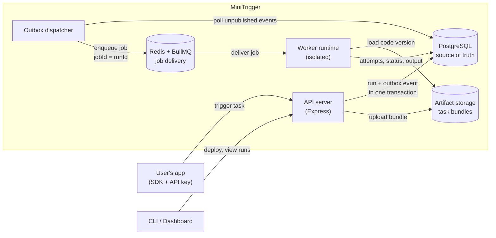
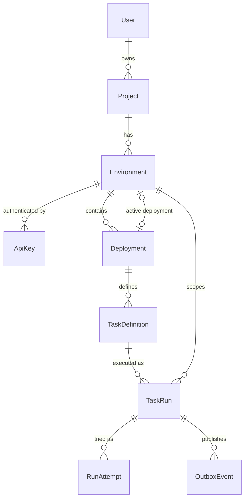
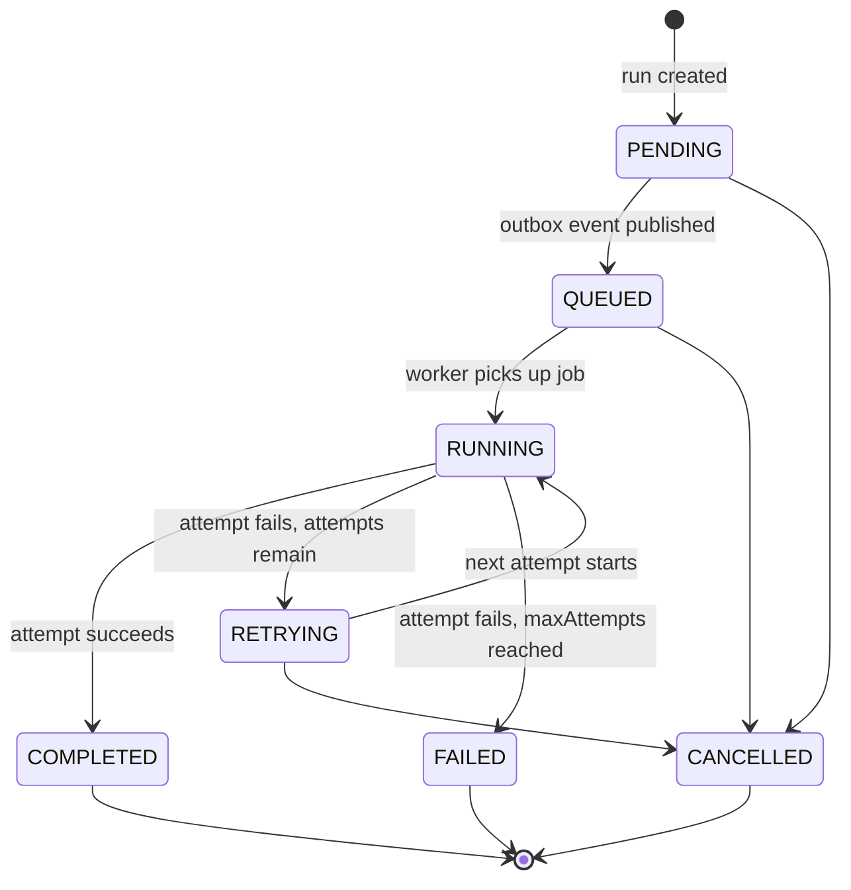
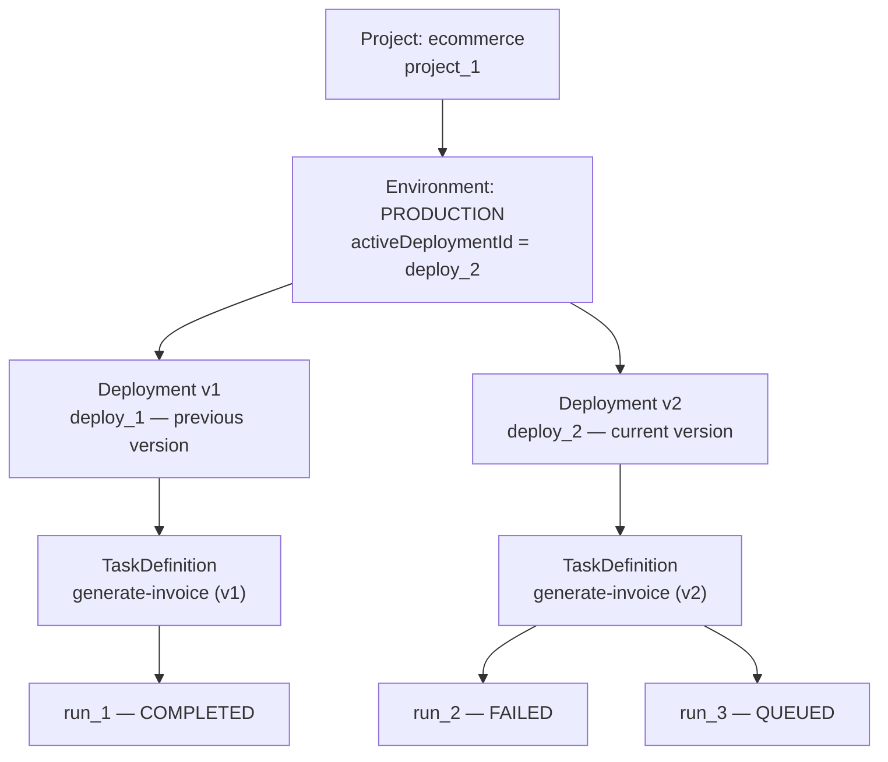

# MiniTrigger V1 — Database Design & Architecture

MiniTrigger uses **PostgreSQL + Prisma** as its source of truth. The design is built around the core concepts used by [Trigger.dev](https://trigger.dev): projects, isolated environments, versioned deployments, task definitions, executions, and retries.

We adopt Trigger.dev's architectural principles, not its schema:

- **Deployed task code is separate from the application that triggers it.** A user's app calls MiniTrigger with an API key; the task code runs in MiniTrigger's workers.
- **Environments are isolated.** Development and production have their own keys, deployments, and runs.
- **Execution is versioned.** Every run records the exact code version it is meant to execute.

This document is the V1 baseline. We won't redesign it for every new endpoint; it evolves through Prisma migrations when a real requirement demands it.

---

## 1. System architecture



Each component has one job:

| Component            | Responsibility                                                                 |
| -------------------- | ------------------------------------------------------------------------------ |
| **API server**       | Authenticates users and API keys, registers deployments, creates runs.         |
| **PostgreSQL**       | Persistent source of truth for projects, deployments, runs, attempts, results. |
| **Outbox dispatcher**| Moves newly created runs from PostgreSQL into the queue reliably.              |
| **Redis + BullMQ**   | Job delivery, delayed execution, and worker coordination. Not a database of record. |
| **Worker runtime**   | Loads the correct versioned bundle and executes the task in isolation.         |
| **Artifact storage** | Immutable task bundles — local disk in development, object storage later.      |

The key rule: **if PostgreSQL and Redis ever disagree, PostgreSQL wins.** Redis can be flushed and rebuilt from the database; the reverse is not true.

---

## 2. Data model

### Entity relationships



Read it top to bottom as a hierarchy:

1. A **User** owns many **Projects** (one per application, e.g. `ecommerce`).
2. Each project has at most one **Environment** per type (`DEVELOPMENT`, `STAGING`, `PRODUCTION`).
3. Each environment has its own **ApiKeys** and its own history of **Deployments** (v1, v2, v3…). Exactly one deployment can be marked *active* — that's the code new runs will use.
4. Each deployment contains the **TaskDefinitions** found in that code version (e.g. `generate-invoice`).
5. Triggering a task creates a **TaskRun** pinned to one specific task definition — and therefore to one specific code version.
6. Each execution try of a run is a **RunAttempt**. Retries add attempts; they never create a new run.
7. **OutboxEvent** is the bridge from the database to the queue (see [section 6](#6-reliable-queueing-with-the-outbox)).

### Tables

| Table            | Main fields                                                         | Why we need it                      |
| ---------------- | ------------------------------------------------------------------- | ----------------------------------- |
| `User`           | id, username, email, passwordHash                                   | Developer identity                  |
| `Project`        | id, ownerId, name, slug                                             | Isolate separate applications       |
| `Environment`    | id, projectId, type, activeDeploymentId                             | Separate development and production |
| `ApiKey`         | id, environmentId, keyPrefix, keyHash, revokedAt                    | Secure SDK access                   |
| `Deployment`     | id, environmentId, version, artifactPath, status                    | Store uploaded code versions        |
| `TaskDefinition` | id, deploymentId, slug, entryPoint                                  | Identify executable functions       |
| `TaskRun`        | id, taskDefinitionId, environmentId, status, payload, output, error | Record each logical execution       |
| `RunAttempt`     | id, taskRunId, attemptNumber, status, error                         | Record retries and failures         |
| `OutboxEvent`    | id, runId, eventType, publishedAt                                   | Prevent lost queue submissions      |

The first eight tables model the platform. `OutboxEvent` is a small reliability addition, needed because PostgreSQL and Redis cannot take part in one ordinary database transaction.

**Why there is no `Task` table:** for V1, a task is identified by its `slug`, which is unique within a deployment. Each run points to a specific versioned `TaskDefinition`, so a separate version-independent `Task` table would add a join without answering any question we need answered yet.

---

## 3. Prisma schema

Targets **Prisma 6.x** (validated with Prisma 6.19). Pin the Prisma version in `package.json` instead of allowing automatic major upgrades.

```prisma
generator client {
  provider = "prisma-client-js"
}

datasource db {
  provider = "postgresql"
  url      = env("DATABASE_URL")
}

enum EnvironmentType {
  DEVELOPMENT
  STAGING
  PRODUCTION
}

enum DeploymentStatus {
  UPLOADING
  BUILDING
  READY
  FAILED
}

enum RunStatus {
  PENDING
  QUEUED
  RUNNING
  RETRYING
  COMPLETED
  FAILED
  CANCELLED
}

enum AttemptStatus {
  RUNNING
  COMPLETED
  FAILED
}

model User {
  id           String    @id @default(uuid())
  username     String
  email        String    @unique
  passwordHash String
  createdAt    DateTime  @default(now())
  updatedAt    DateTime  @updatedAt

  projects     Project[]
}

model Project {
  id        String   @id @default(uuid())
  ownerId   String
  name      String
  slug      String
  createdAt DateTime @default(now())
  updatedAt DateTime @updatedAt

  owner        User          @relation(fields: [ownerId], references: [id])
  environments Environment[]

  @@unique([ownerId, slug])
  @@index([ownerId])
}

model Environment {
  id                 String          @id @default(uuid())
  projectId          String
  type               EnvironmentType
  activeDeploymentId String?         @unique
  createdAt          DateTime        @default(now())

  project            Project         @relation(fields: [projectId], references: [id])
  activeDeployment   Deployment?     @relation("ActiveDeployment", fields: [activeDeploymentId], references: [id], onDelete: NoAction)
  deployments        Deployment[]    @relation("EnvironmentDeployments")
  apiKeys            ApiKey[]
  runs               TaskRun[]

  @@unique([projectId, type])
}

model ApiKey {
  id            String    @id @default(uuid())
  environmentId String
  keyPrefix     String
  keyHash       String    @unique
  createdAt     DateTime  @default(now())
  revokedAt     DateTime?

  environment   Environment @relation(fields: [environmentId], references: [id])

  @@index([environmentId])
  @@index([keyPrefix])
}

model Deployment {
  id             String           @id @default(uuid())
  environmentId  String
  version        Int
  artifactPath   String?
  artifactSha256 String?
  status         DeploymentStatus @default(UPLOADING)
  createdAt      DateTime         @default(now())
  readyAt        DateTime?

  environment    Environment      @relation("EnvironmentDeployments", fields: [environmentId], references: [id])
  activeIn       Environment?     @relation("ActiveDeployment")
  tasks          TaskDefinition[]

  @@unique([environmentId, version])
  @@index([environmentId, status])
}

model TaskDefinition {
  id            String   @id @default(uuid())
  deploymentId  String
  slug          String
  entryPoint    String
  maxAttempts   Int      @default(3)
  createdAt     DateTime @default(now())

  deployment    Deployment @relation(fields: [deploymentId], references: [id])
  runs          TaskRun[]

  @@unique([deploymentId, slug])
}

model TaskRun {
  id               String    @id @default(uuid())
  environmentId    String
  taskDefinitionId String
  status           RunStatus @default(PENDING)

  payload          Json
  output           Json?
  error            Json?

  idempotencyKey   String?
  attemptCount     Int       @default(0)
  scheduledAt      DateTime?
  createdAt        DateTime  @default(now())
  startedAt        DateTime?
  completedAt      DateTime?

  environment      Environment    @relation(fields: [environmentId], references: [id])
  taskDefinition   TaskDefinition @relation(fields: [taskDefinitionId], references: [id])
  attempts         RunAttempt[]
  outboxEvents     OutboxEvent[]

  @@unique([environmentId, idempotencyKey])
  @@index([environmentId, createdAt])
  @@index([environmentId, status, createdAt])
  @@index([taskDefinitionId, createdAt])
}

model RunAttempt {
  id            String        @id @default(uuid())
  taskRunId     String
  attemptNumber Int
  status        AttemptStatus @default(RUNNING)
  startedAt     DateTime      @default(now())
  finishedAt    DateTime?
  error         Json?

  taskRun       TaskRun @relation(fields: [taskRunId], references: [id])

  @@unique([taskRunId, attemptNumber])
}

model OutboxEvent {
  id          String    @id @default(uuid())
  runId       String
  eventType   String
  createdAt   DateTime  @default(now())
  publishedAt DateTime?
  retryCount  Int       @default(0)

  run         TaskRun @relation(fields: [runId], references: [id])

  @@index([publishedAt, createdAt])
}
```

### Notes on specific schema choices

- **Active deployment is a one-to-one link.** `Environment.activeDeploymentId` is `@unique`, so a deployment can be active in at most one environment (it only belongs to one anyway). The reverse side is `Deployment.activeIn`. The two relations between `Environment` and `Deployment` are told apart by name: `"EnvironmentDeployments"` (all versions) and `"ActiveDeployment"` (the current one).
- **`Project` slugs are unique per owner**, not globally — two users can both have an `ecommerce` project.
- **`@@unique([projectId, type])`** is what rejects a second `PRODUCTION` environment in the same project.
- **`@@unique([environmentId, version])`** keeps deployment versions sequential and unambiguous per environment.
- **Idempotency keys are optional.** PostgreSQL treats `NULL`s as distinct in unique constraints, so runs without a key never conflict, while two runs with the same key in the same environment are rejected.
- **Run indexes match the dashboard queries:** "recent runs in this environment", "recent failed runs in this environment", and "recent runs of this task".
- **`OutboxEvent @@index([publishedAt, createdAt])`** supports the dispatcher's query: oldest events where `publishedAt IS NULL`.
- **`payload`, `output`, `error` are `Json`**, so task inputs and results don't need schema changes per task.

---

## 4. Rules the schema can't enforce on its own

Foreign keys guarantee that referenced rows *exist*, but not that they're the *right* rows. These rules are enforced in the service layer:

| Rule                       | What it means                                                                                   | Enforced by |
| -------------------------- | ----------------------------------------------------------------------------------------------- | ----------- |
| **Deployment consistency** | An environment's active deployment must belong to that same environment.                        | Application transaction (later: composite FK) |
| **Execution consistency**  | A run's task definition must belong to a deployment in the run's environment.                   | Application transaction (later: composite FK) |
| **Deployment readiness**   | An environment can only activate a deployment whose status is `READY`.                          | Deployment service |
| **Version immutability**   | Once a deployment is `READY`, its artifact and task definitions must not change.                | Deployment service |
| **Run lifecycle**          | Status changes must follow the allowed transitions below.                                       | Run service, via guarded updates |

Lifecycle rules live in one dedicated **run service**, not scattered across controllers. A *guarded update* includes the expected current status in the `WHERE` clause, so a concurrent change makes the update affect zero rows instead of silently overwriting:

```ts
// Only moves QUEUED -> RUNNING; returns count 0 if another worker got there first.
await prisma.taskRun.updateMany({
  where: { id: runId, status: 'QUEUED' },
  data: { status: 'RUNNING', startedAt: new Date() },
});
```

### Run lifecycle (proposed transitions)



`COMPLETED`, `FAILED`, and `CANCELLED` are terminal — no transition leaves them.

### API key storage

Store only a cryptographically secure hash of each key (`keyHash`). The raw key is shown to the user **once**, at creation, and never stored or returned again. `keyPrefix` (the first few characters) lets the dashboard show which key is which and narrows the lookup during authentication. Revoking a key sets `revokedAt` instead of deleting the row, so past usage stays auditable.

---

## 5. Worked example

A developer creates a project called `ecommerce`, selects the production environment, and deploys code containing a `generate-invoice` task — first as v1, then again as v2.



This is why versioning matters. `run_1` was triggered while v1 was active, so it points to v1's `generate-invoice`. Deploying v2 doesn't change that — `run_1` still records exactly which code it ran. New runs (`run_2`, `run_3`) point to v2's definition.

The two `generate-invoice` rows are separate `TaskDefinition` records with the same slug in different deployments; `@@unique([deploymentId, slug])` allows that.

If `run_2` failed and then retried, the database would hold one `TaskRun` (`run_2`) with several `RunAttempt` rows (attempt 1 `FAILED`, attempt 2 …), not several runs.

---

## 6. Reliable queueing with the outbox

### The problem

Creating a run means two writes in two different systems: insert into PostgreSQL, and enqueue in Redis. They can't share a transaction. If the server crashes between them, we either get a run that never executes (DB write succeeded, enqueue lost) or a job for a run that doesn't exist (enqueue succeeded, DB write rolled back).

### The solution

Write the run **and** an outbox event in one PostgreSQL transaction, and let a separate dispatcher do the enqueueing:

```mermaid
sequenceDiagram
    participant App as User's app
    participant API as API server
    participant PG as PostgreSQL
    participant D as Outbox dispatcher
    participant Q as Redis / BullMQ
    participant W as Worker

    App->>API: trigger "generate-invoice"
    API->>PG: BEGIN; insert TaskRun (PENDING) + OutboxEvent; COMMIT
    API-->>App: 202 { runId }
    D->>PG: select events where publishedAt IS NULL
    D->>Q: add job (jobId = runId)
    D->>PG: set publishedAt, run status QUEUED
    Q->>W: deliver job
    W->>PG: create RunAttempt, run RUNNING
    W->>PG: attempt COMPLETED/FAILED, update run
```

- If the dispatcher crashes after enqueueing but before marking the event published, it will publish again. Using the **run ID as the BullMQ job ID** makes that second enqueue a no-op instead of a duplicate job.
- Retries and crashes can still cause a task to execute more than once (e.g. a worker dies after the task's side effect but before recording success). This is *at-least-once* delivery, so **task handlers must make their side effects idempotent** where it matters — for example, by checking whether an invoice already exists before creating one.

---

## 7. Implementation sequence

- [ ] Create the Prisma schema and PostgreSQL migration
- [ ] Implement user authentication and project creation
- [ ] Create project environments and scoped API keys
- [ ] Register versioned deployment metadata
- [ ] Upload task artifacts and register task definitions
- [ ] Trigger tasks and persist task runs
- [ ] Publish runs through the outbox and BullMQ
- [ ] Execute task code in an isolated worker runtime
- [ ] Record execution attempts, results and retries
- [ ] Build run-history and deployment APIs for the dashboard

### First milestone

Start with `User`, `Project`, and `Environment` and their relationships. Acceptance tests should verify that:

1. A user can create a project.
2. The user can create a `DEVELOPMENT` environment in it.
3. The user can create a `PRODUCTION` environment in it.
4. Creating a second environment of an existing type in the same project is rejected.

Then move on to deployments and task registration.
